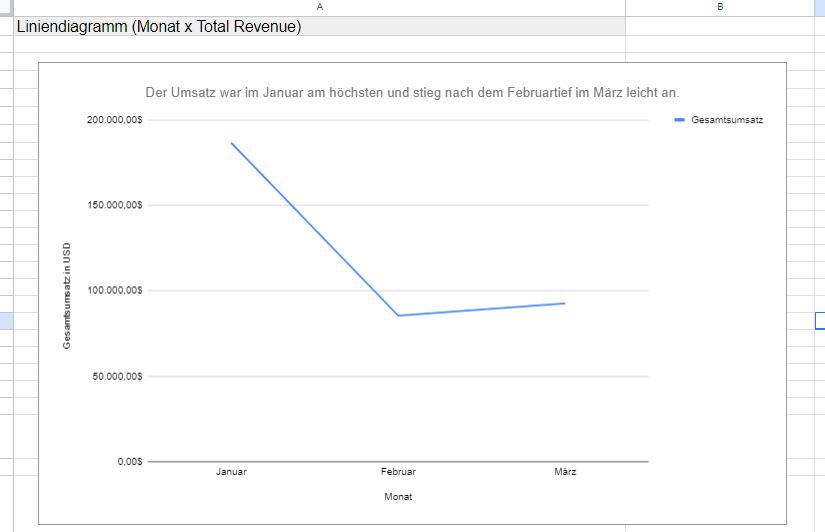
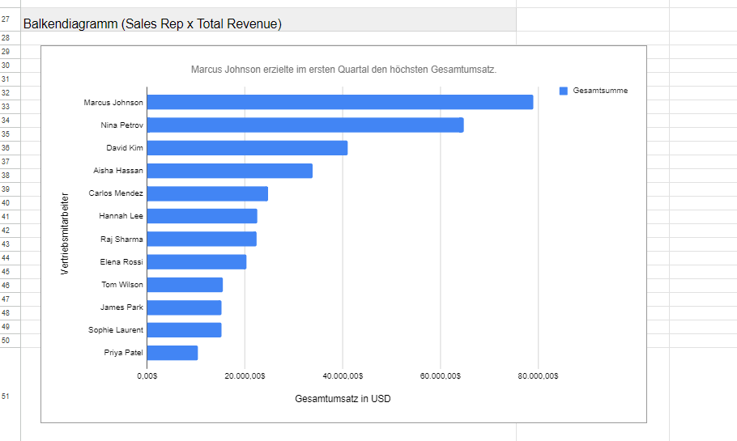
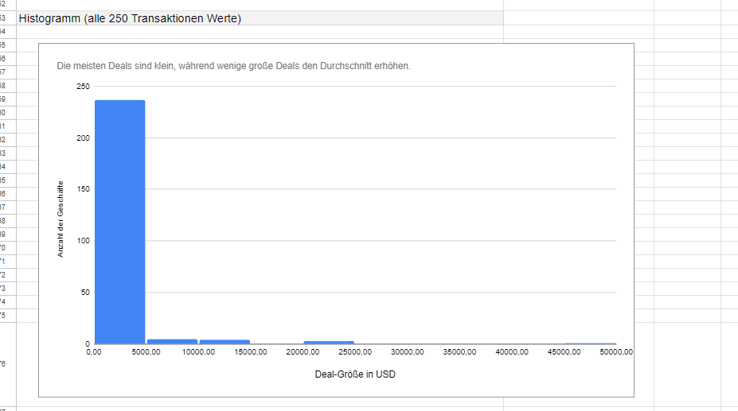

# PeakFlow – Vertriebsanalyse Q1 2025

Abschlussprojekt zur Analyse von Vertriebsdaten mit **Google Sheets**. Das Projekt umfasst Datenbereinigung, deskriptive Statistik, Pivot-Tabellen und Visualisierungen.

## Projektziel

Die Analyse untersucht folgende Fragen:

- Wie entwickelt sich der Umsatz im ersten Quartal 2025?
- Welche Regionen und Produktkategorien erzielen die höchsten Umsätze?
- Welche Vertriebsmitarbeiter fallen durch Dealanzahl und Dealgröße auf?
- Wie beeinflussen große Einzelabschlüsse die Umsatzverteilung?

## Daten und Bereinigung

Der Ausgangsdatensatz enthält 254 Datensätze. Nach der Bereinigung verbleiben **250 eindeutige Geschäfte**.

Durchgeführte Schritte:

- Zwei Testdatensätze entfernt.
- Zwei doppelte Datensätze anhand der DealID entfernt.
- Schreibweisen von Kategorien und Regionen vereinheitlicht.
- Überflüssige Leerzeichen und nicht druckbare Zeichen bereinigt.
- Zahlenwerte in ein auswertbares Format umgewandelt.
- Umsatz als **Stückzahl × Stückpreis** neu berechnet.

Die ursprünglichen Daten bleiben in einem separaten Tabellenblatt erhalten.

### Datenkontext

Die im Datensatz verwendeten Kunden- und Mitarbeiternamen sind fiktiv. Die Daten werden im Rahmen eines Abschlussprojekts analysiert.

## Wichtigste Ergebnisse

| Kennzahl | Ergebnis |
|---|---:|
| Anzahl der Geschäfte | 250 |
| Gesamtumsatz | 364.634,55 $ |
| Durchschnittlicher Umsatz pro Geschäft | 1.458,54 $ |
| Median des Umsatzes pro Geschäft | 386,76 $ |

### Erkenntnisse

- **Große Einzelabschlüsse prägen das Gesamtergebnis.** Der Durchschnitt liegt deutlich über dem Median, was auf eine rechtsschiefe Umsatzverteilung hinweist.
- **Enterprise Plans tragen überproportional zum Umsatz bei.** Sie machen 23 von 250 Geschäften aus und erzielen rund 46,9 % des Gesamtumsatzes.
- **APAC erzielt den höchsten regionalen Umsatz** mit 120.025,49 $.
- **Januar ist der umsatzstärkste Monat** mit 186.600,12 $. Im Februar fällt der Umsatz auf 85.430,35 $ und steigt im März auf 92.604,08 $.
- **Marcus Johnson erzielt den höchsten Gesamtumsatz** mit 78.951,97 $ bei 37 Geschäften.

Die Ergebnisse beschreiben das untersuchte Quartal. Sie erlauben allein keine Aussagen über langfristige Trends oder die Ursachen der Unterschiede.

## Werkzeuge und Methoden

- Google Sheets
- Datenbereinigung mit Text- und Zahlenfunktionen
- Bedingte Aggregationen, Filter und Sortierungen
- Deskriptive Statistik, einschließlich Median, Quartilen und Standardabweichung
- Pivot-Tabellen
- Linien-, Balken- und Streudiagramme sowie Histogramm

## Visualisierungen

### Umsatzentwicklung im ersten Quartal

### Umsatz nach Vertriebsmitarbeiter

### Verteilung der Dealgrößen

## Aufbau der Arbeitsmappe

| Tabellenblatt | Inhalt |
|---|---|
| `peakflow_q1_2025_dirty` | Unveränderte Rohdaten |
| `Geschäfte` | Bereinigte Daten und Hilfsberechnungen |
| `Zusammenfassung` | Kennzahlen und Auswertungen nach Monat, Region und Kategorie |
| `Pivot-Tabellen` | Auswertungen nach Vertriebsmitarbeiter, Kategorie und Region |
| `Top-Performer` | Ranglisten und größte Einzelabschlüsse |
| `Diagramme` | Visualisierungen und Hilfstabellen |
| `README` | Dokumentation der Bereinigung und Ergebnisse |

## Hinweise zur Nutzung

Die Analyse wurde in Google Sheets erstellt und die Arbeitsmappe als XLSX exportiert. Google-Sheets-spezifische Formeln und Pivot-Tabellen können in Excel abweichend funktionieren. Eine vollständige Neuberechnung in Excel wurde bisher nicht bestätigt.

## Projektstatus

Die Projektdatei und ausgewählte Visualisierungen sind im Repository enthalten. Die Analyse und ihre Ergebnisse sind dokumentiert.

## Projektdatei

[Arbeitsmappe herunterladen](PeakFlow_Suryandi_Suryandi.xlsx)

## Autor

Suryandi Suryandi
